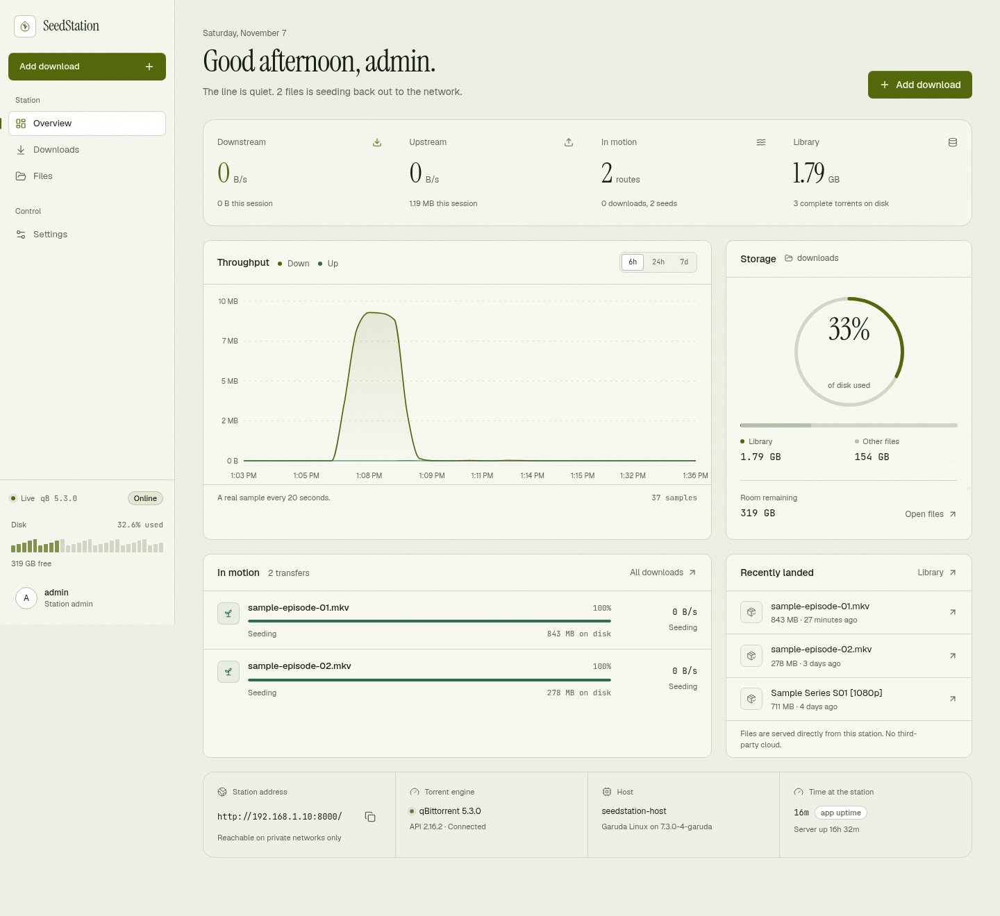
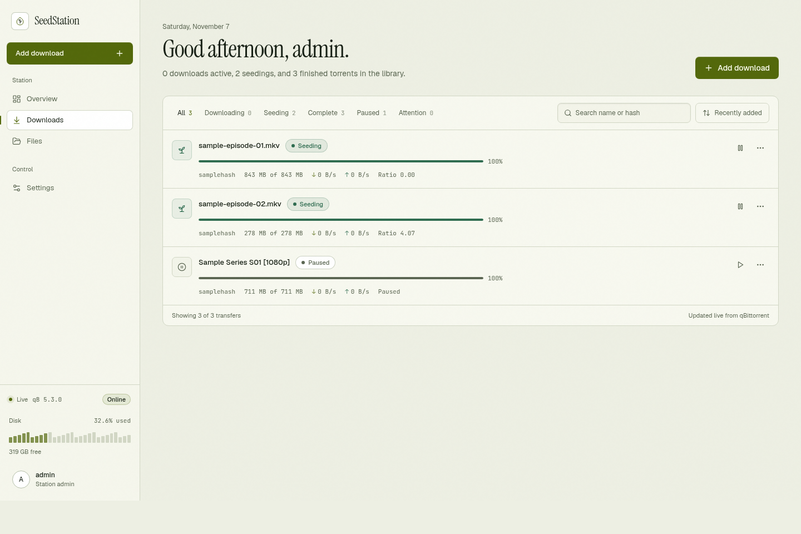
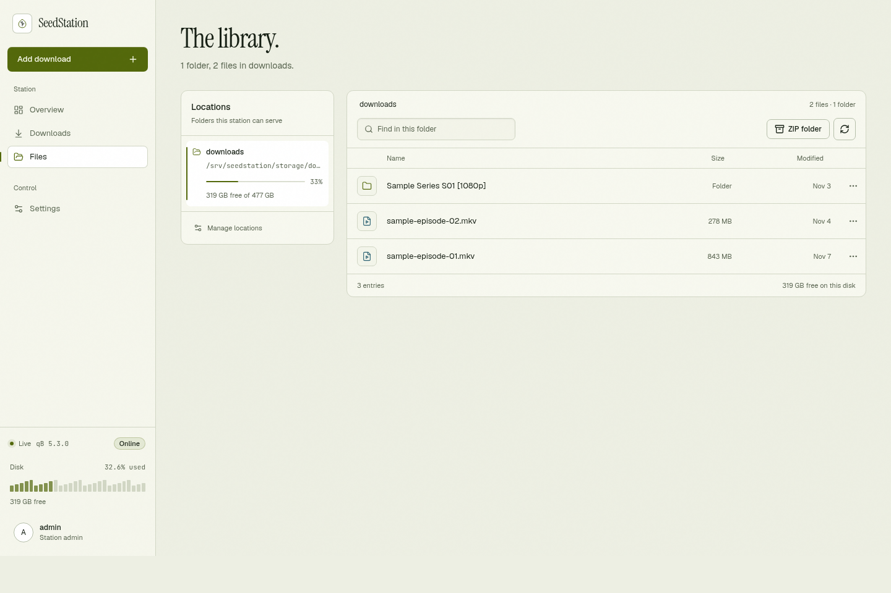
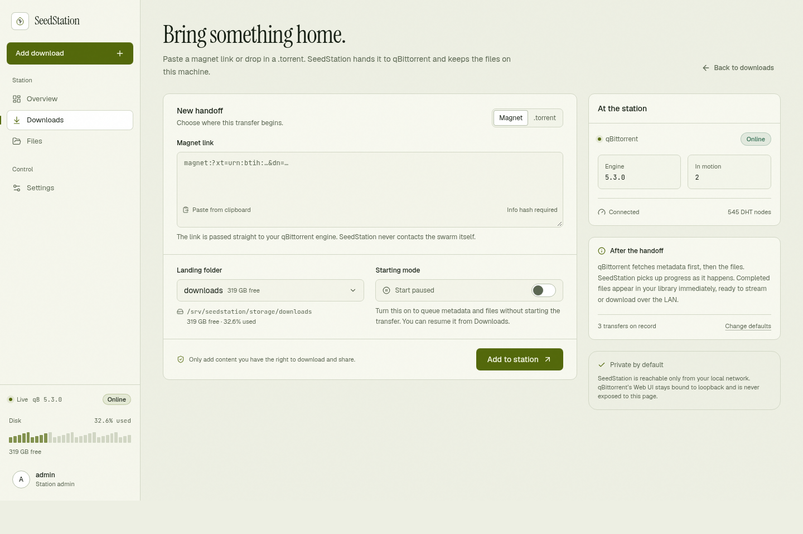
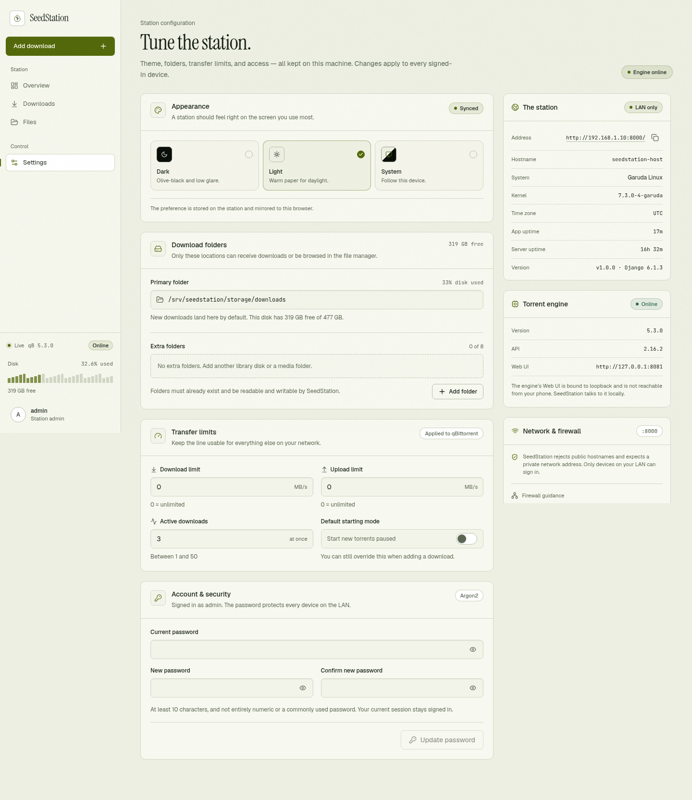
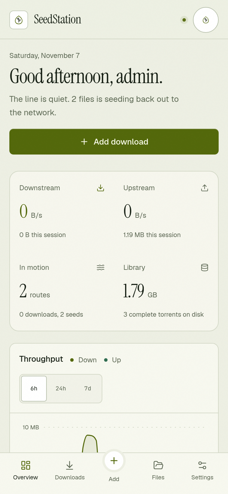
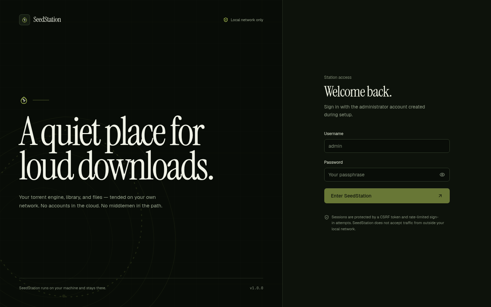

# SeedStation

**A quiet home for your downloads.** A self-hosted torrent download station and
LAN file server with a polished React interface, live transfer stats, previews,
and a private qBittorrent engine.

[](https://github.com/YAC223E/seedstation/actions/workflows/ci.yml)
[](https://www.python.org/)
[](https://www.djangoproject.com/)
[](https://react.dev/)
[](LICENSE)

<p align="center">
  
</p>

> **Lawful use only.** SeedStation is a general-purpose BitTorrent client. Use it
> only for content you created, public-domain material, or media you have
> permission to download and share. You are responsible for what you transfer.

---

## Why SeedStation

Most torrent web UIs are either a thin wrapper around a desktop client or a
public seedbox. SeedStation is built for the machine under your desk: one
trusted LAN, one administrator, a private engine, and an interface that feels
good on a phone at 2 a.m.

- **No cloud middlemen.** Your files, database, and credentials stay on your
  machine.
- **Isolated engine.** A dedicated qBittorrent profile with a loopback-only Web
  UI. It never touches another qBittorrent instance.
- **Stable local address.** `seedstation.local` follows the laptop when it
  switches between Ethernet and Wi-Fi.
- **Designed for the couch.** Mobile-first layout, safe-area support, installable
  home-screen icon, and media previews that fit the screen.

## What it does

- **Dashboard** with real transfer speeds, queue counts, storage, recent files,
  and telemetry history charts.
- **Downloads** with magnet links and `.torrent` uploads, pause/resume, recheck,
  per-file selection and Normal/High/Max priorities inside multi-file torrents,
  filtering, sorting, and confirmed deletion (optionally with files).
- **File manager** over explicitly allow-listed download directories: browse,
  text/PDF/image/video/audio previews, downloads, folder ZIP archives, and
  confirmed deletion.
- **Add Download** with destination selection, start-paused default, and clear
  validation.
- **Settings** for theme, download roots, speed limits, active-download limits,
  start-paused behavior, password changes, and engine/network diagnostics.
- **Live updates** over WebSockets with an automatic REST polling fallback.
- **iPhone-friendly** layout, installable home-screen icon, Range streaming for
  Safari media playback, and a dark/light/system theme.

## Screenshots

| Dashboard | Downloads |
| --- | --- |
|  |  |

| Files | Add download |
| --- | --- |
|  |  |

| Settings | Mobile |
| --- | --- |
|  |  |

| Sign in |
| --- |
|  |

## Architecture

```
 iPhone / laptop / tablet
          │  HTTP :8000 (trusted LAN)
          ▼
 ┌──────────────────────────────────────────────┐
 │ Daphne → Django + DRF + Channels + WhiteNoise│
 │  React build served from frontend/dist       │
 │  SQLite: backend/instance/seedstation.sqlite3│
 └───────────────────┬──────────────────────────┘
                     │ loopback only, :8081
                     ▼
        qBittorrent-nox (isolated profile)
        BitTorrent :6881 · storage/downloads
```

The browser never talks to qBittorrent directly. Django validates every request,
talks to the engine's Web API on loopback, and normalizes its responses. Hashed
frontend assets are served by WhiteNoise from the Django process, so there is no
separate reverse proxy to configure.

A deeper breakdown is in [`docs/TECH_STACK.md`](docs/TECH_STACK.md).

## Tech stack

| Layer | Choice |
| --- | --- |
| Backend | Python 3.12+, Django 6.1, Django REST Framework, Channels, Daphne |
| Database | SQLite |
| Engine | qBittorrent-nox 5.x via `qbittorrent-api`, loopback Web UI |
| Frontend | React 19, TypeScript 7, Vite 8, Tailwind CSS 4 |
| UI | React Router, TanStack Query, Radix UI, Recharts, Lucide, Sonner |
| Assets | Fontsource (Geist, JetBrains Mono, Instrument Serif), WhiteNoise |
| Persistence | systemd user services, Avahi mDNS |
| Testing | pytest, pytest-django, `tsc -b` + Vite build, GitHub Actions |

Exact versions, rationale, and the component map are in
[`docs/TECH_STACK.md`](docs/TECH_STACK.md).

## Requirements

- Linux (developed on Garuda Linux / Arch)
- Python **3.12+**
- Node.js **20.19+** or **22.12+** and npm (build-time only)
- `qbittorrent-nox` **5.x** — install it with your package manager, or place a
  binary at `tools/qbittorrent-nox`
- `curl` and `ss` for the lifecycle scripts
- Optional: `avahi-daemon` and `avahi-utils` for `seedstation.local`

On Arch/Garuda:

```bash
sudo pacman -S python nodejs npm qbittorrent-nox avahi
```

## Quick start

```bash
git clone https://github.com/YAC223E/seedstation.git
cd seedstation
./scripts/setup.sh       # venv, frontend build, database, admin, engine profile
./scripts/start.sh       # starts the engine, then Daphne
./scripts/status.sh
```

Open `http://<laptop-lan-ip>:8000` from a device on the same network.

The administrator username is `admin` by default. The initial password is in
`.env` (`SEEDSTATION_ADMIN_PASSWORD`); change it after signing in from
**Settings → Account**. The setup script does not print secrets.

Useful setup options:

```bash
./scripts/setup.sh --dev            # also install pytest
./scripts/setup.sh --skip-frontend  # reuse an existing frontend/dist
./scripts/setup.sh --start          # start immediately after setup
```

### Stable address with mDNS

If Avahi is installed, the optional systemd installer publishes
`http://seedstation.local:8000`. The name is independent of the DHCP address and
follows the active default route when the machine switches between Ethernet and
Wi-Fi:

```bash
./scripts/stop.sh
./scripts/install-systemd.sh
loginctl enable-linger "$USER"
```

Verify it with:

```bash
avahi-resolve -n seedstation.local
curl -I http://seedstation.local:8000
```

The alias is configurable with `SEEDSTATION_MDNS_NAME` in `.env`. Android
browsers do not reliably resolve `.local` names; use a DHCP reservation or the
Tailscale name for Android devices.

### iPhone home-screen app

1. Connect the iPhone to the same Wi-Fi/LAN.
2. Open `http://seedstation.local:8000` (or the LAN IP) in Safari.
3. Share → **Add to Home Screen**.

The app provides a web manifest and touch icons. There is no service worker, so
it needs the station to be reachable; it is not an offline app. Service workers
also require HTTPS on phones, so an offline PWA is a future addition rather than
a current promise.

## Lifecycle scripts

| Command | Purpose |
| --- | --- |
| `./scripts/setup.sh` | Creates `.env` with random secrets (if missing), installs Python deps, builds the frontend, migrates SQLite, creates the admin, makes the qBittorrent profile. Idempotent; never overwrites an existing `.env`. |
| `./scripts/start.sh` | Runs migrations, starts the isolated engine on `127.0.0.1:8081`, applies saved speed/queue settings, starts Daphne on `0.0.0.0:8000`, and waits for health checks. |
| `./scripts/stop.sh` | Stops only SeedStation's engine and web server after verifying their PID command lines. Never touches another qBittorrent process. |
| `./scripts/status.sh` | Shows health, PIDs, LAN URL, mDNS URL, disk space, and warns when a qBittorrent WebUI is listening on a non-loopback address. |
| `./scripts/install-systemd.sh` | Optional: installs systemd **user** units and starts them. |
| `./scripts/install-systemd.sh --remove` | Removes the units, keeps data and `.env`. |

Logs live in `.run/daphne.log` and `.run/qbittorrent.log`; PID files are in
`.run/`. The scripts refuse to act on stale PIDs or a foreign process.

### Persistent systemd user services

```bash
./scripts/stop.sh                    # avoid two engines fighting for ports
./scripts/install-systemd.sh
systemctl --user status seedstation.target
journalctl --user -u seedstation-web -u seedstation-qbittorrent -u seedstation-mdns -f
```

The installer creates:

- `seedstation.target` — groups the stack
- `seedstation-web.service` — Daphne + Django
- `seedstation-qbittorrent.service` — isolated engine
- `seedstation-mdns.service` — stable `seedstation.local` alias

To keep the station running after logout and start it at boot:

```bash
loginctl enable-linger "$USER"
```

When systemd units are active, `start.sh` and `stop.sh` direct you to
`systemctl --user` instead of starting a second copy.

## Configuration

Configuration lives in `.env` at the project root (created by setup, mode 600).
`.env.example` documents every key. Restart the station after changing `.env`.

| Key | Default | Notes |
| --- | --- | --- |
| `SEEDSTATION_SECRET_KEY` | generated | Required Django secret. Changing it invalidates sessions. |
| `SEEDSTATION_PORT` | `8000` | Django/Daphne port. |
| `SEEDSTATION_MDNS_NAME` | `seedstation.local` | Stable mDNS alias published by `seedstation-mdns.service`. |
| `SEEDSTATION_TIME_ZONE` | system timezone | Used by Django and timestamps. |
| `SEEDSTATION_ALLOWED_HOSTS` | localhost only | Extra Host header names; loopback, private IPs and `*.local` are already allowed. |
| `SEEDSTATION_LAN_ONLY` | `true` | Rejects non-private Host headers. Keep this on. |
| `SEEDSTATION_SECURE_COOKIES` | `false` | Set `true` only after putting the app behind HTTPS. |
| `SEEDSTATION_DOWNLOAD_DIR` | `storage/downloads` | Absolute download root. |
| `SEEDSTATION_EXTRA_DIRS` | empty | Comma-separated additional file-manager roots. |
| `SEEDSTATION_ADMIN_USERNAME` | `admin` | Initial admin account name. |
| `SEEDSTATION_ADMIN_EMAIL` | `admin@seedstation.local` | Admin email. |
| `SEEDSTATION_ADMIN_PASSWORD` | generated | Used only when creating the admin or when resetting it explicitly. |
| `SEEDSTATION_QBIT_HOST` | `127.0.0.1` | Keep loopback. |
| `SEEDSTATION_QBIT_PORT` | `8081` | Isolated qBittorrent WebUI. |
| `SEEDSTATION_QBIT_TORRENT_PORT` | `6881` | BitTorrent listen port. |
| `SEEDSTATION_QBIT_USERNAME` / `_PASSWORD` | generated | Credentials for SeedStation's private qBittorrent profile. |
| `SEEDSTATION_LOG_LEVEL` | `INFO` | Python log level. |

Theme, speed limits, active-download limits, start-paused, and download roots are
stored in SQLite and edited from **Settings**, not `.env`. SeedStation pushes
speed/queue changes to the running engine immediately and again on startup.

The qBittorrent WebUI password is stored as a PBKDF2 hash in
`.qbittorrent/qBittorrent/config/qBittorrent.conf`. If you change
`SEEDSTATION_QBIT_PASSWORD`, stop the engine and regenerate the profile:

```bash
./scripts/stop.sh
.venv/bin/python scripts/generate_qbit_config.py --force
./scripts/start.sh
```

## Security model

SeedStation is designed for a **trusted LAN**, not the public internet.

- Session authentication with Argon2 password hashing; CSRF protection on all
  writes; SameSite=Lax cookies.
- LAN host validation and security headers (CSP, frame denial, nosniff, referrer
  policy, permissions policy).
- Login rate limiting/lockout and audited auth events.
- All file paths are resolved and checked against configured roots; symlinks
  escaping a root are rejected. File deletion requires explicit `DELETE`
  confirmation and never removes a root.
- Torrents can only be added with a destination inside a configured root.
- qBittorrent's API is loopback-only and never exposed to the browser.
- Uploads are capped (10 MB for torrent files, 12 MB request body).

This is a single-user, trusted-LAN app. It has no multi-tenant isolation. Do not
share an account or expose it to untrusted networks.

### Firewall and network exposure

- Allow the web port from your LAN only. With UFW:
  ```bash
  sudo ufw allow from 192.168.0.0/16 to any port 8000 proto tcp
  ```
  Adjust the subnet to match your network.
- Allow the BitTorrent listen port for peer connectivity if you want inbound
  peers (optional; outbound connections still work without it):
  ```bash
  sudo ufw allow 6881/tcp
  sudo ufw allow 6881/udp
  ```
- **Never port-forward port 8000 or the qBittorrent WebUI (8081) from your
  router.** The app has no TLS by default and is not hardened for the internet.
- The SeedStation qBittorrent WebUI binds to `127.0.0.1` only. Verify with:
  ```bash
  ss -ltnp | grep 8081
  ```
- Torrent traffic can reveal your IP to peers and trackers. Use a VPN or other
  network protection if that matters for your lawful use case.

### Check the existing qBittorrent GUI on port 8080

A normal desktop qBittorrent installation often enables its WebUI on
`*:8080` (all interfaces) with a default password. SeedStation **does not
modify or stop that process**, but it is a LAN exposure risk. Check:

```bash
ss -ltnp | grep ':8080'
```

If it is listening on `0.0.0.0`, `*`, or `[::]`, open the qBittorrent GUI and go
to **Tools → Options → Web UI**, then either disable the Web UI or bind it to
`127.0.0.1`. Alternatively, close the GUI app when you do not need it. SeedStation
will show a warning in `status.sh` and in its Settings diagnostics panel.

## File previews and streaming

The file manager supports:

- images (`png`, `jpg`, `webp`, `gif`, `avif`, etc.)
- video/audio streaming with HTTP `Range` (`206 Partial Content`), suitable for
  iPhone Safari
- text-like files up to 512 KB with truncation
- PDFs and documents in an embedded preview where the browser supports it
- folder downloads as ZIP (stored, streamed)

Safari cannot play every container/codec. MP4 (H.264/AAC) is the safest choice
for iPhone playback; MKV support varies by codec and iOS version.

## Verification

The backend suite covers auth, settings, path guards, file streaming, ZIP,
torrent validation, normalization, and live snapshots:

```bash
cd backend
"$(realpath ../.venv)/bin/python" -m pytest -q
```

The frontend must typecheck and build:

```bash
cd frontend
npm run build
```

A full local integration run was performed with synthetic, self-created torrents,
a loopback tracker, and a second isolated qBittorrent seeder. It exercised magnet
add (start-paused), pause/resume/recheck, `.torrent` upload, completion, file
listing, text/image/video previews, Range `206` streaming, ZIP contents, file and
torrent deletion, path guards, and engine restart degradation/recovery. No
third-party media was used for testing.

The mobile audit and accessibility results are recorded in
[`docs/FRONTEND_AUDIT.md`](docs/FRONTEND_AUDIT.md).

## Troubleshooting

**The engine is offline.** Run `./scripts/status.sh` and read
`.run/qbittorrent.log`. Confirm port 8081 is free and the credentials in `.env`
match `.qbittorrent/qBittorrent/config/qBittorrent.conf`. If they diverged,
regenerate the profile (see above).

**Port already in use.** Something else owns 8000, 8081, or 6881. The scripts
refuse to kill a foreign process. Change `SEEDSTATION_PORT` /
`SEEDSTATION_QBIT_PORT`, or stop the other service.

**The LAN address stopped working after switching networks.** The DHCP address
changed. Use `http://seedstation.local:8000` instead, or give the laptop a DHCP
reservation. Check the current address with `./scripts/status.sh`.

**`seedstation.local` does not resolve.** Confirm Avahi is running
(`systemctl status avahi-daemon`), the mDNS service is active
(`systemctl --user status seedstation-mdns.service`), and the device supports
mDNS. Android browsers generally do not resolve `.local`; use a DHCP reservation
or Tailscale.

**Download folder permission denied.** Ensure the user running SeedStation can
read/write the folder. The Settings page validates this and reports an error
instead of saving an inaccessible path.

**iPhone video will not play.** Use an MP4/H.264 file. Range support is present,
but the browser still has to support the container and codecs.

**Forgot the admin password.** Set a new value as
`SEEDSTATION_ADMIN_PASSWORD` in `.env`, then run:

```bash
cd backend
"$(realpath ../.venv)/bin/python" manage.py bootstrap_admin --reset-password
```

Or use `"$(realpath ../.venv)/bin/python" manage.py changepassword admin`. Restart is not
required for the password itself, but restart after editing `.env` to reload
other settings.

**Stale PID file.** The scripts verify `/proc/<pid>/cmdline` before acting. If a
PID file points at an unrelated process, they refuse to kill it. Remove the stale
file in `.run/` after confirming no SeedStation process is running.

**Admin static files look unstyled.** Run
`cd backend && "$(realpath ../.venv)/bin/python" manage.py collectstatic --noinput`, or rerun
`./scripts/setup.sh`.

**A new frontend build is not visible.** WhiteNoise serves hashed assets. Restart
the web service after `npm run build`:

```bash
systemctl --user restart seedstation-web.service
```

## Data and backup

Important paths:

| Path | Contents |
| --- | --- |
| `.env` | Secrets and configuration (mode 600) |
| `backend/instance/seedstation.sqlite3` | Users, settings, telemetry samples, audit events |
| `storage/downloads/` | Default download root |
| `.qbittorrent/` | Isolated engine profile and resume data |

For a consistent backup, stop the station first, then copy `.env`,
`backend/instance/`, and `.qbittorrent/`; downloads can be copied separately.
Never commit `.env` or the database to a public repository.

## Project layout

```
seedstation/
├── backend/                 Django project, REST/WS APIs, tests
│   ├── apps/                accounts, core, torrents, files, dashboard
│   ├── config/              settings, ASGI/WSGI, URLs
│   └── instance/            SQLite database (created at runtime)
├── frontend/                React + TypeScript + Vite + Tailwind
│   ├── src/pages/           dashboard, downloads, add, files, settings, login
│   └── dist/                production build served by Django
├── scripts/                 setup/start/stop/status/systemd/mDNS helpers
├── deploy/systemd/          user-unit templates
├── docs/                    tech stack, frontend audit, screenshots
├── tools/                   optional qbittorrent-nox binary (not committed)
├── storage/downloads/       default download root (not committed)
├── .github/workflows/       CI
├── .env.example             documented configuration template
└── README.md
```

## API surface

All endpoints are authenticated unless noted.

- `GET /api/health/` — public health check
- `GET /api/auth/session/` — session/CSRF bootstrap
- `POST /api/auth/login/`, `POST /api/auth/logout/`
- `GET/PATCH /api/settings/`, `GET /api/system/`
- `GET /api/live/`, `GET /api/dashboard/summary/`, `GET /api/dashboard/history/`
- `GET /api/torrents/`, `POST /api/torrents/add-magnet/`,
  `POST /api/torrents/upload/`
- `GET/DELETE /api/torrents/<hash>/`, plus `pause/`, `resume/`, `recheck/`,
  and `files/priority/`
- `GET /api/files/`, `GET /api/files/roots/`, `GET /api/files/download/`,
  `GET /api/files/archive/`, `GET /api/files/text/`, `POST /api/files/delete/`
- `WS /ws/live/` — live snapshots

All write endpoints use session auth and CSRF. Destructive operations require an
explicit confirmation in the UI and a `DELETE` request.

## Contributing

Contributions are welcome. Keep the trusted-LAN security model intact.

1. Fork the repository and create a branch.
2. Run the backend suite and frontend build before opening a pull request.
3. Do not commit `.env`, the SQLite database, downloads, or engine profile data.
4. Describe user-visible changes and include screenshots for UI work.

The CI workflow runs the backend tests and the frontend production build on every
push and pull request.

## License

Released under the [MIT License](LICENSE).

## Acknowledgements

SeedStation stands on the shoulders of qBittorrent, Django, Django REST
Framework, Channels, Daphne, React, Vite, Tailwind CSS, Radix UI, TanStack Query,
Recharts, Lucide, Sonner, and the Fontsource project. Thanks to the maintainers
and communities behind them.
