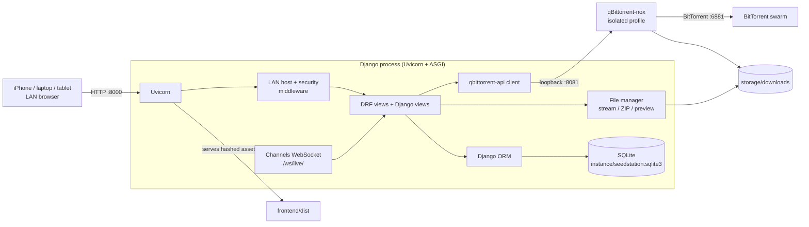

# Tech Stack

SeedStation is a single-machine, self-hosted web application. This document
records the exact stack, why each piece is there, and the versions the project
was built and tested against.

## At a glance

| Layer | Technology | Version used here |
| --- | --- | --- |
| Language (server) | Python | 3.14.8 (project requires 3.12+) |
| Web framework | Django | 6.1.3 |
| API | Django REST Framework | 3.18.3 |
| ASGI server | Uvicorn | 0.54.0 |
| Realtime | Django Channels | 4.3.2 |
| Database | SQLite | 3.54.0 |
| Torrent engine | qBittorrent-nox | 5.3.0 (WebAPI 2.16.2) |
| Engine client | qbittorrent-api | 2026.10.1 |
| Static files | WhiteNoise | 6.12.0 |
| Password hashing | Argon2 via argon2-cffi | 25.1.0 |
| Language (client) | TypeScript | 7.0.2 |
| UI library | React | 19.3.1 |
| Build tool | Vite | 8.3.5 |
| Styling | Tailwind CSS | 4.3.4 |
| Routing | React Router | 7.18.5 |
| Server state | TanStack Query | 5.105.3 |
| Charts | Recharts | 3.10.1 |
| Components | Radix UI primitives | per-package, see `frontend/package.json` |
| Icons | lucide-react | 0.468.0 |
| Toasts | Sonner | 2.0.7 |
| Tests | pytest + pytest-django | 9.2.0 / 4.14.0 |
| Runtime supervisor | systemd user services | systemd |
| Local discovery | Avahi / mDNS | `seedstation.local` |

The frontend was built with Node.js 26.12.1 and npm 12.2.1. Vite 8 requires
Node.js **20.19+** or **22.12+**.

## Architecture

The browser never talks to qBittorrent directly. Django validates the request,
calls qBittorrent's Web API on loopback, and normalizes the response for the
React client.

## Backend

| Package | Purpose |
| --- | --- |
| `Django` | Routing, auth, sessions, ORM, admin, security middleware |
| `djangorestframework` | JSON API used by the React client |
| `channels` | WebSocket consumer for live transfer snapshots |
| `uvicorn` | ASGI server with response flow control, so large downloads do not buffer in memory |
| `qbittorrent-api` | Typed-ish client for the isolated qBittorrent Web API |
| `django-cors-headers` | Optional Vite dev-server CORS support |
| `whitenoise` | Serves the built React assets directly from Django |
| `argon2-cffi` | Argon2 password hashing |
| `zipstream-ng` | Streams folder downloads as ZIP without a temp archive |
| `bencode.py` | Torrent metadata parsing and validation |
| `python-dotenv` | Loads `.env` at startup |
| `requests` | HTTP calls that are not covered by the engine client |

SQLite is deliberate: the app is single-user and self-hosted, so a zero-config
database file is more useful than a database server. The database lives at
`backend/instance/seedstation.sqlite3` and is excluded from git.

## Frontend

| Package | Purpose |
| --- | --- |
| `react` / `react-dom` | UI runtime |
| `typescript` | Type checking across the app |
| `vite` | Dev server and production build |
| `tailwindcss` + `@tailwindcss/vite` | Utility-first styling and theme tokens |
| `react-router-dom` | Client-side routes and auth guards |
| `@tanstack/react-query` | API caching, retries, mutations, polling fallback |
| `@radix-ui/*` | Accessible dialogs, dropdowns, selects, switches, tooltips |
| `recharts` | Throughput and telemetry history charts |
| `lucide-react` | Icon set |
| `sonner` | Accessible toast notifications |
| `class-variance-authority` | Component variants |
| `clsx` + `tailwind-merge` | Conditional and conflict-free class names |
| `@fontsource-variable/geist` | Interface typeface |
| `@fontsource-variable/jetbrains-mono` | Data and monospace typeface |
| `@fontsource/instrument-serif` | Display headings |

The production bundle is built into `frontend/dist/` and served by WhiteNoise.
`frontend/dist/` and `frontend/node_modules/` are intentionally excluded from
git; `./scripts/setup.sh` (or `npm run build`) creates the bundle.

## Engine and OS integration

- **qBittorrent-nox 5.3.0** runs under a private profile at `.qbittorrent/` with
  its Web UI bound to `127.0.0.1:8081`. The default BitTorrent port is `6881`.
- **Uvicorn** binds to `0.0.0.0:8000` so phones on the trusted LAN can connect.
- **systemd user services** (`seedstation.target`, `seedstation-web.service`,
  `seedstation-qbittorrent.service`, `seedstation-mdns.service`) keep the stack
  alive across logout and reboot. `loginctl enable-linger` is required for
  boot-time startup without an interactive login.
- **Avahi** publishes `seedstation.local`, a stable mDNS name that follows the
  active default route when the machine switches between Ethernet and Wi-Fi.
- **WhiteNoise** serves the hashed Vite assets from the Django process, so
  there is no separate reverse proxy or CDN to configure.

## Testing and quality

- Backend: `pytest` + `pytest-django`, 63 tests covering auth, settings, path
  guards, file streaming, ZIP creation, torrent validation, normalization, and
  live snapshots.
- Frontend: `tsc -b` type check followed by a Vite production build.
- Accessibility: aXe WCAG checks were run over the login, dashboard, downloads,
  files, add-download, and settings screens with 0 violations at the time of the
  audit. See [`docs/FRONTEND_AUDIT.md`](FRONTEND_AUDIT.md).
- Continuous integration: GitHub Actions runs the backend suite and the frontend
  build on every push and pull request.

## Deliberate non-choices

- **No Docker requirement.** SeedStation targets a personal Linux machine and
  uses systemd directly.
- **No external database.** SQLite keeps setup and backups to one file.
- **No cloud services.** There is no telemetry, auth provider, or hosted API.
- **No public-internet exposure.** The default security model is a trusted LAN.
  Put it behind a VPN or a properly configured reverse proxy if you need remote
  access.
- **No service worker yet.** The app is installable on iOS via Add to Home
  Screen, but it is not an offline application. A future PWA pass would need
  HTTPS for service-worker support on phones.
